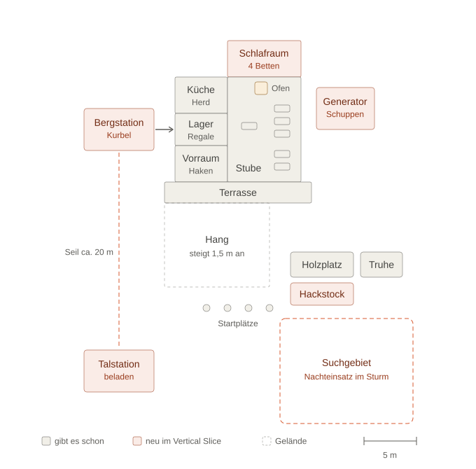

# Skizze: Hütte und Umgebung (Vertical Slice)

> **Status**: Skizze, vom Entwickler am 2026-11-08 für gut befunden
> **Zweck**: Grundlage für das spätere Dokument „Hütten-Layout“ (vor dem Bau der Seilbahn, Plan-Schritt
> „Lager und Materialseilbahn“ in `production/milestones/vertical-slice.md`)
> **Gebaut**: nein. Gebaut wird erst, wenn der Gate-Check den Bau des Vertical Slice freigibt (Stand
> 2026-11-09: FAIL). Die Szene bleibt bis dahin unverändert.

Draufsicht, oben = bergauf, unten = Tal. Maßstab 15 px pro Meter. Grau gibt es schon in der Graubox
(`docs/GRAUBOX.md`), orange ist neu im Vertical Slice, gestrichelt ist Gelände.

## Orte

Koordinaten in Metern wie in der Graubox (x nach rechts, z nach hinten = bergauf). Neue Orte sind nur
ungefähr gesetzt; die echten Maße legt das Dokument „Hütten-Layout“ fest.

| Ort | Neu? | x | z | Notiz |
|---|---|---|---|---|
| Vorraum | nein | −6 … −1 | 12 … 15,5 | Haken für die Ausrüstung (Stirnlampe, Seil, Funkgerät) |
| Lager | nein | −6 … −1 | 15,5 … 18,5 | Neue Seitentür in der Westwand zur Bergstation |
| Küche | nein | −6 … −1 | 18,5 … 22 | Herd an der Rückwand |
| Stube | nein | −1 … 6 | 12 … 22 | Ofen bei (2,2 / 20,9), Tische wie heute, Hundekorb neben dem Ofen |
| Schlafraum | ja | −1 … 6 | 22 … 25,5 | 4 Betten, Tür aus der Stube |
| Generator-Schuppen | ja | 7,5 … 13 | 17 … 21 | Draußen neben der Stube |
| Seilbahn-Bergstation | ja | −14,5 … −8 | 15 … 19 | Kurbel, direkt neben dem Lager |
| Seilbahn-Talstation | ja | −14,5 … −8 | −8 … −4 | Hier wird beladen; Seil etwa 20 m |
| Terrasse | nein | −7 … 7 | 10 … 12 | |
| Hang | nein | −7 … 3 | 2 … 10 | Steigt von 0 auf 1,5 m |
| Startplätze | nein | −3, −1, 1, 3 | 0 | |
| Holzplatz | nein | 5 … 11 | etwa 3 … 5 | Lage ungefähr wie in der Szene |
| Hackstock | ja | 5 … 11 | etwa 0 … 2,5 | Direkt vor dem Holzplatz |
| Truhe | nein | etwa 12 … 16 | etwa 3 … 5 | Lage ungefähr wie in der Szene |
| Suchgebiet Nachteinsatz | ja | 4 … 16 | −11 … −1 | Abseits vom Weg zur Talstation |

## Warum so

- **Schlafraum hinter der Stube:** Die Familie geht zum Schlafen durch die Stube und erlebt Kälte, Lärm und
  Chaos mit. Betten machen passiert mitten im Trubel (Säule Gemütlichkeit und Teamwork unter Druck).
- **Bergstation am Lager:** Was mit der Seilbahn ankommt, ist nach wenigen Schritten verstaut. Unten belädt
  einer, oben kurbelt einer; beide sind getrennt und müssen sich absprechen (`docs/KONZEPT.md`,
  Materialseilbahn).
- **Generator draußen:** Fällt in der Nacht der Strom aus, muss jemand in den Sturm hinaus.
- **Hackstock am Holzplatz:** Holz liegen, hacken, über die Terrasse zum Ofen tragen, etwa 15 m.
- **Suchgebiet abseits der Talstation:** Nachteinsatz und Seilbahn kreuzen sich nicht, die Gruppe teilt sich
  wirklich auf.
- **Herd → Stube:** Vom Herd zum hintersten Tisch sind es etwa 13 m. Das bleibt unter der vorläufigen
  Grenze von etwa 15 m fürs Servieren; den genauen Wert legt das GDD zur Versorgung fest.

## Verworfene Varianten

- **Matratzenlager unterm Dach mit Treppe:** sehr alpin, aber Tragen über eine Treppe ist für den Vertical
  Slice zu teuer. Bleibt als Idee für später.
- **Seilbahn auf der Ostseite:** dort stehen schon Holzplatz und Truhe; es würde draußen zu eng.

## Was die endgültigen Maße festlegt

Die Skizze ist absichtlich grob. Abstände und Größen hängen von noch offenen GDDs ab: Gäste und
Bedürfnisse (Betten), Versorgung und Kochen (Wege zum Servieren), Holz hacken, Lager und Seilbahn,
Wetter und Ereignisse (Generator) und Nachteinsatz (Größe des Suchgebiets). Wenn diese stehen, entsteht
daraus das Dokument „Hütten-Layout“ (`level-designer`, ggf. `/team-level`).
